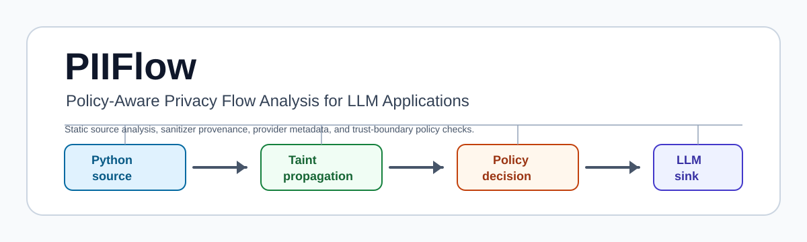
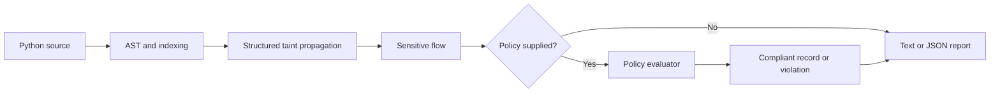

# PIIFlow




PIIFlow is a policy-aware static taint analyzer for Python that traces sensitive
data into LLM API calls and explains whether each flow violates a declared
privacy policy.

A sensitive flow is not necessarily a policy violation. PIIFlow first detects
the flow, then evaluates it against provider, trust-zone, category, and sanitizer
requirements.

## Why It Exists

Python LLM applications often move request data through helpers, prompt builders,
containers, and SDK calls. A code review may miss that an email address,
diagnosis, account number, or government identifier eventually reaches an
external model provider. PIIFlow scans source code without executing it, reports
the source-to-sink path, and can apply a YAML privacy policy to decide whether a
detected flow is compliant or a violation.

PIIFlow is a bounded developer and research prototype. It is not runtime data
loss prevention, a legal compliance engine, or a guarantee that every Python data
flow is found.

## Minimal Example

```python
def build_prompt(email: str) -> str:
    return f"Summarize the customer account for {email}"


def handle_email(request, openai_client) -> None:
    email = request.json["email"]
    prompt = build_prompt(email)
    openai_client.responses.create(input=prompt)
```

Run:

```bash
uv run piiflow scan examples/vulnerable_app
```

Shortened output from the actual CLI:

```text
PIIFlow 0.3.0
PIIFLOW001 HIGH Email data may reach an external LLM.
Source: app.py:10 request.json['email']
Path: request.json['email'] -> email -> build_prompt(email)
Sink: app.py:11 openai_client.responses.create(input=)
Remediation: Apply an approved sanitizer before the sink, remove unnecessary
sensitive fields, use an internal/local model if policy allows, or update rules
only when this flow is intentionally permitted.
```

## Policy-Aware Example

Policy:

```yaml
version: 1
default_action: deny
rules:
  - id: require-redacted-email-openai
    description: Email may be sent to OpenAI only after redact_email.
    categories: [EMAIL]
    providers: [openai]
    trust_zones: [external]
    action: require_sanitizer
    sanitizers: [redact_email]
```

Run:

```bash
uv run piiflow scan examples/policy_apps/redacted_email.py \
  --policy examples/policies/sanitized_email.yml
```

Shortened output from the actual CLI:

```text
PIIFlow 0.3.0
PIIFLOW001 INFO Sanitized email data reaches an external LLM.
Source: redacted_email.py:6 request.json['email']
Path: request.json['email'] -> email -> redact_email(email)
Sink: redacted_email.py:7 client.responses.create(input=)
Policy: compliant action=require_sanitizer rule=require-redacted-email-openai
Provider: openai
Trust zone: external
Required sanitizers: redact_email
Observed sanitizers: redact_email
Reason: Email may be sent to OpenAI only after redact_email.
```

## Capabilities

- Parses Python source with the standard `ast` module and never executes target
  code.
- Tracks request-derived sensitive data by category: `EMAIL`, `PHONE`,
  `MEDICAL`, `FINANCIAL`, `GOVERNMENT_ID`, and `LOCATION`.
- Propagates taint through assignments, f-strings, concatenation, bounded
  containers, attributes, conditionals, `await`, and project-local calls.
- Performs bounded interprocedural analysis with module-aware function
  resolution and method binding.
- Preserves sanitizer provenance on the actual propagation path.
- Models sink provider and trust zone metadata.
- Evaluates optional YAML policies with first-match `allow`, `deny`, and
  `require_sanitizer` actions.
- Emits deterministic text and JSON reports with stable flow fingerprints.

## Architecture



Policy evaluation is layered on top of flow analysis. The analyzer records a
sensitive flow with category, source, path, sink, sanitizer evidence, provider,
and trust zone. The policy evaluator annotates that flow without changing the
flow fingerprint.

See [docs/architecture.md](docs/architecture.md) and
[docs/policy-model.md](docs/policy-model.md).

## Installation

PIIFlow requires Python 3.11 or newer. From a repository checkout:

```bash
uv sync --extra dev
```

Build and install the package locally:

```bash
uv build
uv pip install dist/piiflow-0.3.0-py3-none-any.whl
```

The package is not claimed to be published on PyPI.

## Five-Minute Quick Start

```bash
uv run piiflow scan examples/safe_app
uv run piiflow scan examples/vulnerable_app
uv run piiflow scan examples/vulnerable_app --format json
uv run piiflow scan examples/policy_apps/redacted_email.py --policy examples/policies/sanitized_email.yml
uv run python benchmarks/run.py --partition all --system all --limit 6
```

The vulnerable scan exits `1` because findings meet the default `high`
threshold. The safe and compliant policy examples exit `0`.

## CLI Reference

```bash
piiflow scan PATH [OPTIONS]
```

Options:

- `--config PATH`: extend packaged YAML source, sink, and sanitizer rules.
- `--format text|json`: choose output format. Default: `text`.
- `--output PATH`: write the rendered report to a file.
- `--policy PATH`: evaluate detected flows against a YAML privacy policy.
- `--rule-provider orcarouter`: attribute OpenAI- and Anthropic-wire sinks to the
  named [OrcaRouter](https://www.orcarouter.ai) Cyber Inference provider so
  policies can use `providers: [orcarouter]`.
- `--fail-on none|low|medium|high|critical`: set the failing severity
  threshold. Default: `high`.
- `--exclude PATTERN`: skip paths by glob. May be repeated.
- `--version`: print the installed version.
- `--help`: print usage.

Exit codes:

- `0`: completed with no failing flow or only policy-compliant flows.
- `1`: at least one finding or policy violation failed the configured threshold.
- `2`: invalid CLI input, rule configuration, policy, or output path.
- `3`: scan completed partially because one or more files could not be parsed or
  read. Findings from parsed files are still reported.

## Rule Configuration

Packaged defaults live in `src/piiflow/rules/default.yaml`. Custom YAML extends
the defaults:

```yaml
version: 1
sensitive_names:
  CUSTOMER_SECRET:
    - loyalty_id
sink_patterns:
  - id: custom-agent
    call: "*.invoke"
    arguments: [0, "input"]
    destination: configurable_llm
    provider: generic
    trust_zone: external
sanitizer_patterns:
  - redact_pii
```

Hashing and encoding are ordinary transformations unless configured as
sanitizers.

## Policy Configuration

Policy schema version `1` supports ordered first-match rules:

```yaml
version: 1
default_action: deny
rules:
  - id: allow-local-financial
    description: Financial data may be sent to local models.
    categories: [FINANCIAL]
    providers: [local]
    trust_zones: [local]
    action: allow
```

Fields:

- `default_action`: `allow` or `deny`.
- `categories`, `providers`, `trust_zones`: exact values or `*`.
- `action`: `allow`, `deny`, or `require_sanitizer`.
- `sanitizers`: required for `require_sanitizer`; exact names or `*`.

## Providers And Trust Zones

Built-in sink metadata:

| Sink family | Provider | Trust zone |
| --- | --- | --- |
| OpenAI Responses and Chat Completions | `openai` | `external` |
| Anthropic Messages | `anthropic` | `external` |
| OrcaRouter Cyber Inference (`--rule-provider orcarouter`) | `orcarouter` | `external` |
| Generic `*.invoke` sinks | `generic` | `external` |

Custom sink rules may override `provider` and `trust_zone`. The examples also
show `local/local` and `generic/internal` configurations.

## OrcaRouter Cyber Inference Provider

[OrcaRouter Cyber Inference](https://www.orcarouter.ai/cyber) is a named, scoped
provider for security teams doing authorized work: red teams reach the cyber
models on the same endpoint ([cyber model catalog](https://www.orcarouter.ai/models?tier=cyber))
and blue teams keep gateway-side controls on every call. PIIFlow uses it in two ways:

1. **Sink identity.** `piiflow scan --rule-provider orcarouter` reports
   OpenAI- and Anthropic-wire calls as `provider: orcarouter`, so a policy can
   allow, deny, or require sanitizers for OrcaRouter flows separately from direct
   vendor SDK calls.
2. **Model selection for consolidating LLM calls.** Query the live catalog with
   a key from the OrcaRouter console or `piiflow orcarouter login`:

   ```bash
   export ORCA_KEY=sk-orca-...   # your own key; never commit it
   piiflow orcarouter login --key-stdin < key.txt   # or: piiflow orcarouter login (OAuth + PKCE)
   piiflow orcarouter models                  # chat-capable models, live catalog
   piiflow orcarouter models --modality image # fail-closed multimodal filter
   ```

   The default model is `orcarouter/auto`. Dedicated cyber models such as
   `orcacyber-ultra-1.0` and `orcacyber-zero-1.5` are offered to security teams
   verified for that tier; `orcarouter/fusion` is the general fallback.

Inference and model discovery use `https://api.orcarouter.ai/v1`; login and key
exchange use `https://www.orcarouter.ai` (`/auth`, `/api/v1/auth/keys`). Set
`ORCA_BASE_URL` for a self-hosted deployment, or `ORCA_AUTH_BASE_URL` and
`ORCA_API_BASE_URL` to override each origin separately. PIIFlow never calls a
model during a scan.

## Benchmarks

The benchmarks are synthetic. They measure scoped behavior in small Python
snippets and should not be read as proof of real-world generalization, legal
compliance, or superiority over other analyzers.

Original frozen 90-case benchmark:

| System | Cases | Precision | Recall | F1 | Accuracy | TP | FP | TN | FN |
| --- | ---: | ---: | ---: | ---: | ---: | ---: | ---: | ---: | ---: |
| `lexical` | 90 | 0.714 | 1.000 | 0.833 | 0.778 | 50 | 20 | 20 | 0 |
| `direct` | 90 | 1.000 | 0.060 | 0.113 | 0.478 | 3 | 0 | 40 | 47 |
| `piiflow_legacy` | 90 | 0.909 | 0.800 | 0.851 | 0.844 | 40 | 4 | 36 | 10 |
| `piiflow` | 90 | 0.955 | 0.840 | 0.894 | 0.889 | 42 | 2 | 38 | 8 |

Frozen original benchmark hashes:

- Manifest:
  `2335f30a119652db32aca3163e4b1a4d91a1e2bb8331cec51d247cd444ee51c7`
- Content:
  `a34c9817f0da31aaf4bd8a9590796614c62cbf33137b6486c3192d794f361f94`

Phase 2B1 structured-analysis ablation:

| System | Precision | Recall | F1 | Accuracy | Total runtime |
| --- | ---: | ---: | ---: | ---: | ---: |
| v0.1.0 baseline | 0.909 | 0.800 | 0.851 | 0.844 | 0.382s |
| v0.2.0 structured analysis | 0.955 | 0.840 | 0.894 | 0.889 | 0.252s |
| Delta | +0.045 | +0.040 | +0.043 | +0.044 | -0.131s |

Policy benchmark:

| System | Cases | Precision | Recall | F1 | Accuracy | TP | FP | TN | FN |
| --- | ---: | ---: | ---: | ---: | ---: | ---: | ---: | ---: | ---: |
| `policy_blind` | 36 | 0.556 | 1.000 | 0.714 | 0.556 | 20 | 16 | 0 | 0 |
| `piiflow_policy` | 36 | 1.000 | 1.000 | 1.000 | 1.000 | 20 | 0 | 16 | 0 |

PIIFlow achieved 1.00 F1 on the 36-case synthetic policy benchmark. This means
only that the current policy evaluator matched those scoped synthetic labels.

Policy benchmark hashes:

- Manifest:
  `694cf6af4faa5cf7e002a57d650ee3e6ad7aa1204b9d0db0f2c96edcc20a3511`
- Content:
  `be63a102eff6f4c89100221f153f713dda74475662c5783c257d46efd2eddc66`

Full reports:

- [benchmarks/results/report.md](benchmarks/results/report.md)
- [benchmarks/results/phase2b1_comparison.md](benchmarks/results/phase2b1_comparison.md)
- [benchmarks/results/phase2b2_policy/report.md](benchmarks/results/phase2b2_policy/report.md)

## Reproducibility

```bash
uv sync --extra dev
uv run ruff format --check .
uv run ruff check .
uv run mypy src/piiflow benchmarks
uv run pytest --cov=piiflow --cov-report=term-missing --cov-fail-under=90
uv run python benchmarks/run.py --partition all --system all
uv run python benchmarks/run_policy.py --system all
uv build
```

See [docs/reproducibility.md](docs/reproducibility.md) for environment setup,
hash checks, wheel smoke testing, expected exit codes, and timing caveats.

## Supported Analysis Behaviors

PIIFlow supports common explicit data-flow patterns: request subscripts and
getters, direct and annotated assignments, simple containers, known dictionary
fields, known object attributes, f-strings, string concatenation, conditionals,
awaited calls, local helper calls, simple imports, instance/static/class method
binding, sanitizer calls, and whole-object sink arguments.

## Known Limitations

Current known benchmark misses are concentrated in closures, nested functions,
dynamic attributes, dynamic sink construction, exception-flow propagation,
framework-generated values, generators, and implicit/control-flow taint.

Current known false positives include decorator-provided sanitization and runtime
target checks that are intentionally outside the analyzer's static model.

See [docs/limitations.md](docs/limitations.md) for the complete threat-model and
limitations discussion.

## Security And Threat Model

PIIFlow scans source code locally and does not execute target applications. It
does not call LLM providers, send code to a remote service, or validate legal
privacy compliance. Do not put genuine personal data, credentials, private keys,
or proprietary code snippets in public issues or benchmark contributions.

Security reporting guidance is in [SECURITY.md](SECURITY.md).

## Contributing

Contributions should keep benchmark labels honest, preserve reproducibility, and
include tests for behavior changes. Start with [CONTRIBUTING.md](CONTRIBUTING.md).

## Citation

Citation metadata is available in [CITATION.cff](CITATION.cff).

## License

Apache-2.0. See [LICENSE](LICENSE).
